# Assets gerados no Blender

Gerado por `tools/blender/build_all.py` a partir dos scripts `tools/blender/asset_*.py` (cada asset é um script reproduzível; o que não virou script não conta como entregue).

| Asset | Tipo | Triângulos | Orçamento | Arquivo | Tamanho | Medidas (m) | Materiais | Prévia |
|---|---|---|---|---|---|---|---|---|
| anel_dados | modular | 872 ✓ | 3000 | `assets/models/cenario/anel_dados.glb` | 316.8 KB | 4.08 × 1.0 × 4.44 | 1 | 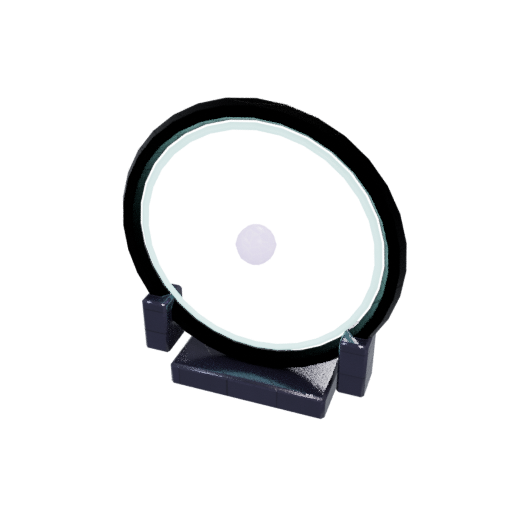 |
| arco_partido | modular | 340 ✓ | 3000 | `assets/models/cenario/arco_partido.glb` | 426.6 KB | 4.631 × 2.032 × 5.445 | 1 | 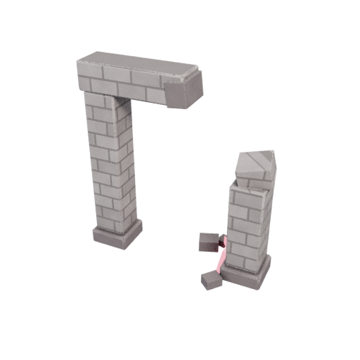 |
| barreira_neon | prop | 136 ✓ | 1500 | `assets/models/cenario/barreira_neon.glb` | 231.7 KB | 2.42 × 0.72 × 1.0 | 1 | 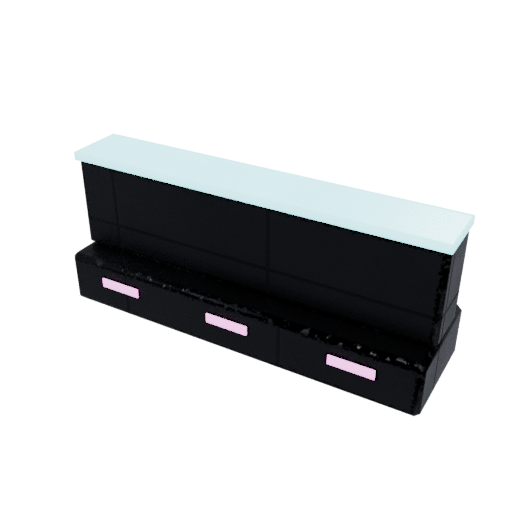 |
| braseiro_rubro | prop | 260 ✓ | 1500 | `assets/models/cenario/braseiro_rubro.glb` | 403.0 KB | 1.092 × 1.12 × 1.694 | 1 | 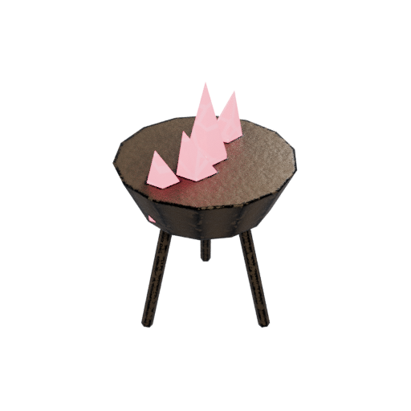 |
| coluna_rachada | prop | 260 ✓ | 1500 | `assets/models/cenario/coluna_rachada.glb` | 360.4 KB | 2.63 × 1.868 × 4.339 | 1 | 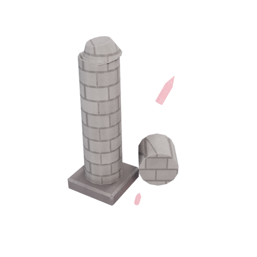 |
| cristal_codigo | prop | 224 ✓ | 1500 | `assets/models/cenario/cristal_codigo.glb` | 393.7 KB | 1.4 × 1.2 × 2.0 | 1 | 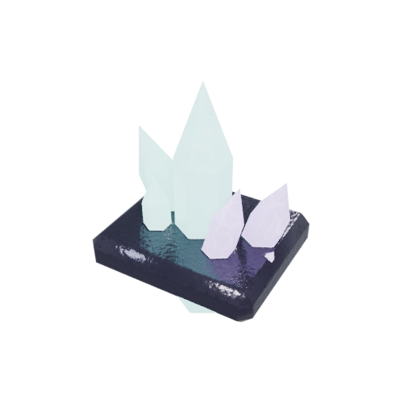 |
| estatua_rei | prop | 568 ✓ | 1500 | `assets/models/cenario/estatua_rei.glb` | 419.4 KB | 1.8 × 1.8 × 3.66 | 1 | 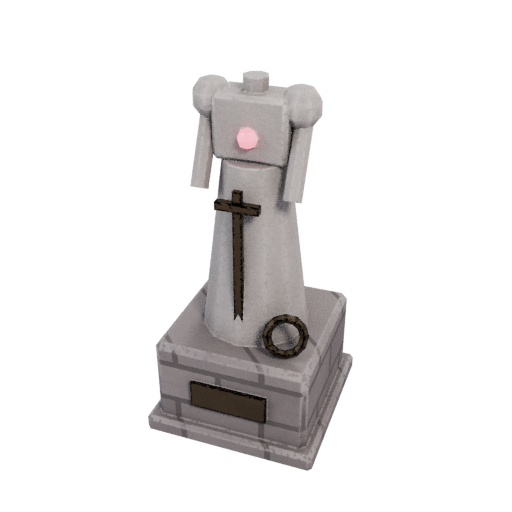 |
| lamina_do_iniciado | arma | 582 ✓ | 1500 | `assets/models/armas/lamina_do_iniciado.glb` | 242.3 KB | 0.21 × 0.052 × 1.003 | 1 | 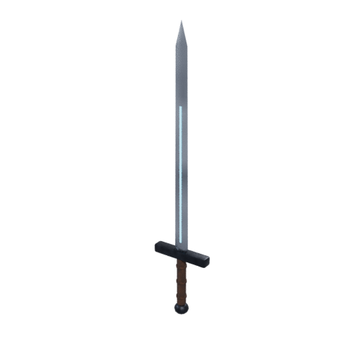 |
| monolito_dados | prop | 290 ✓ | 1500 | `assets/models/cenario/monolito_dados.glb` | 282.8 KB | 3.473 × 4.54 × 4.72 | 1 | 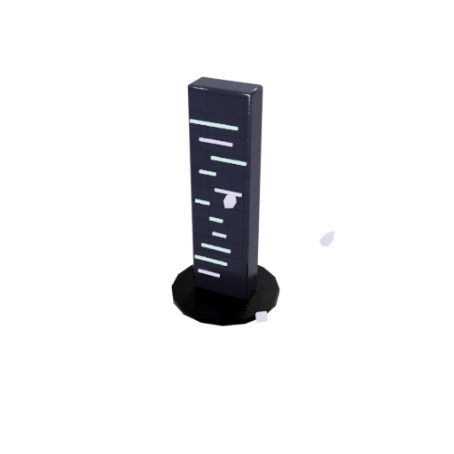 |
| poste_holo | prop | 428 ✓ | 1500 | `assets/models/cenario/poste_holo.glb` | 319.9 KB | 1.525 × 0.95 × 3.85 | 1 | 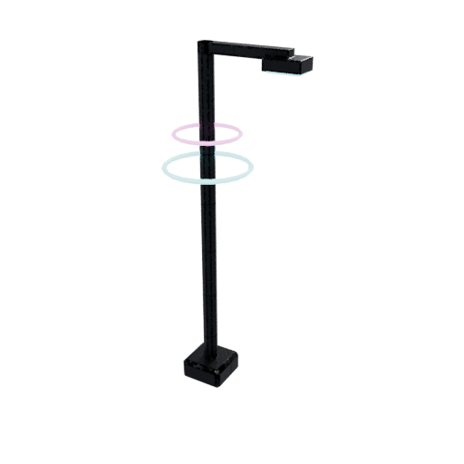 |
| quiosque_neon | prop | 144 ✓ | 1500 | `assets/models/cenario/quiosque_neon.glb` | 252.1 KB | 2.62 × 2.045 × 2.42 | 1 | 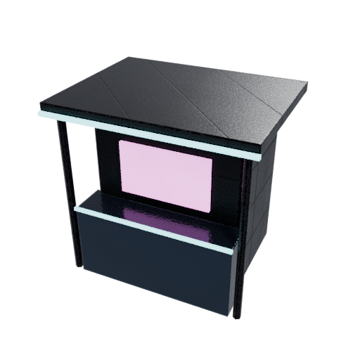 |
| rack_servidor | prop | 440 ✓ | 1500 | `assets/models/cenario/rack_servidor.glb` | 376.2 KB | 0.96 × 0.83 × 2.38 | 1 | 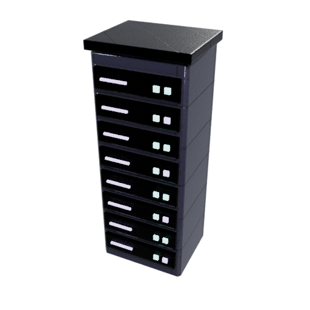 |
| torre_neon | modular | 388 ✓ | 3000 | `assets/models/cenario/torre_neon.glb` | 495.5 KB | 3.0 × 3.0 × 8.65 | 1 | 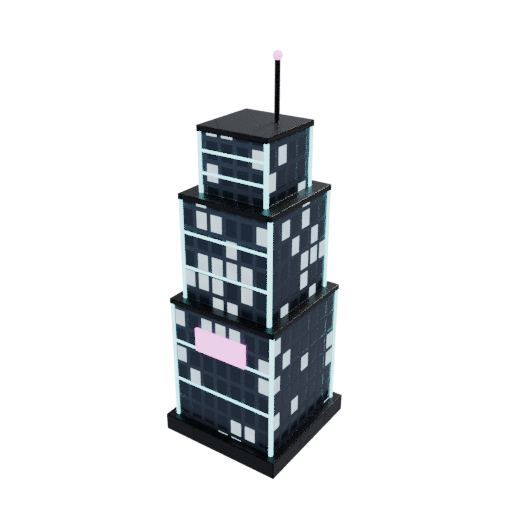 |
